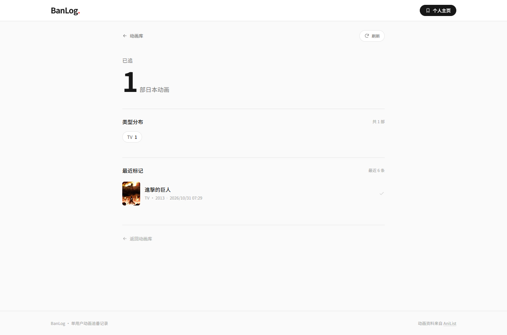

# BanLog

**中文优先、本地优先的日本动画追番记录。**

BanLog 用 AniList 获取动画资料，用本地中文标题映射显示译名，按需翻译简介并缓存进 SQLite。它不要求登录，没有云同步，网页版和 Windows 桌面版都可以直接使用。

[](https://nextjs.org)
[](https://www.typescriptlang.org/)
[](https://www.prisma.io/)
[](https://sqlite.org/)
[](https://learn.microsoft.com/microsoft-edge/webview2/)
[](LICENSE)
[](https://github.com/Sato017/banlog)

> **BanLog** is a local-first anime tracker for Chinese-speaking users: AniList data, locally sourced Chinese titles, cached Chinese synopses, type & genre filters, and a portable Windows app. No account. No cloud.

> **Windows 用户**：可直接下载 [BanLog 2.1.0 便携版](https://github.com/Sato017/banlog/releases/latest)，解压后双击 `BanLog.exe`。


## 功能

- **中文标题**：启动时同步 AniList ID → 中文标题映射，列表直接返回 `titleChinese`。
- **中文简介**：英文 `description` 按需翻译为 `synopsisChinese`，写入数据库后不再重复翻译；失败自动回退英文。
- **类型 + 题材筛选**：TV / 剧场版 / OVA / ONA，以及 Action / Romance / Sci-Fi 等 AniList 题材。
- **横向列表**：封面在左，中文主标题 + 日文原名副标题在右，简介最多 3 行。
- **AniList 列表**：24 部/页，封面优先 `extraLarge`，10 分钟内存缓存。
- **追番记录**：单用户 SQLite，AniList ID 关联，个人主页展示统计与最近标记。
- **桌面版**：原生 WinForms + WebView2，不依赖 Electron。

## 界面

| 类型 + 题材筛选 | 个人主页 |
| --- | --- |
|  |  |

| 移动端 | 数据全部保存在本地 |
| --- | --- |
|  | 单用户、无登录、无云同步；SQLite 文件可直接备份。 |

## 为什么是 BanLog

- **中文体验不是补丁**：中文标题来自本地映射，简介翻译会写库缓存，不是每次打开页面都重新请求。
- **数据看得见**：所有追番记录在本地 SQLite，可导出、备份、离开服务也能保留。
- **筛选更接近找番**：除了 TV / 剧场版 / OVA / ONA，还可以按 Action、Romance、Sci-Fi 等题材过滤。
- **Windows 开箱即用**：便携包自带 Node.js 和 WebView2 外壳，双击 exe 即可。

## 数据与隐私

- 单用户 `local`，没有账号系统。
- `AnimeCache`、`WatchRecord` 只写入本地 SQLite。
- 中文标题只读本地 `data/anilist-chinese.json`，不依赖中文元数据 API。
- 中文简介默认调用 Google Translate；翻译失败会回退英文，不影响页面。
- Windows 便携版默认把数据写到程序旁的 `BanLogData/`。

## 快速开始

要求 Node.js 20+。

```bash
npm install
cp .env.example .env
npm run db:migrate
npm run dev
```

打开 <http://127.0.0.1:3000>。

`npm install`、`npm run dev` 和 `npm run build` 都会自动检查本地中文映射；缺失或超过 24 小时时尝试从 GitHub 同步一次：

```bash
npm run sync:chinese   # 强制立即刷新
```

下载来源按顺序尝试：

1. `https://raw.githubusercontent.com/soruly/anilist-chinese/master/anilist-chinese.json`
2. GitHub Contents API
3. GitHub 镜像

> 注意：该仓库当前的真实文件名是 `anilist-chinese.json`，不是旧示例中的 `data.json`。

映射会规范化为：

```json
{
  "16498": "進擊的巨人",
  "101922": "鬼滅之刃"
}
```

保存到 `data/anilist-chinese.json`。加载器每个 Node 进程只读取一次。源数据为 MIT License，见 `data/anilist-chinese-NOTICE.txt`。

## 如何测试中文标题和简介

### 1. 确认本地映射

```bash
npm run sync:chinese
```

然后检查：

```bash
curl "http://127.0.0.1:3000/api/anime?page=1"
```

返回的每一项都应带 `titleChinese`（有映射时）；例如 id `16498` 应为 `進擊的巨人`。

### 2. 测试真实翻译

默认翻译端点为 Google：

```text
https://translate.googleapis.com/translate_a/single
```

只要运行环境能访问该端点，直接加载页面即可。第一次请求会翻译当前页缺失的中文简介，随后：

```bash
curl "http://127.0.0.1:3000/api/anime?page=1"
```

应包含 `synopsisChinese`，并且数据库已经写入：

```sql
SELECT id, titleChinese, synopsisChinese FROM AnimeCache LIMIT 5;
```

第二次请求同一页时，会直接读取 `AnimeCache.synopsisChinese`，不会再次调用翻译服务。

### 3. 无外网时的可重复测试

项目内置了一个 Google Translate 兼容 mock：

```bash
# 终端 1
npm run mock:translate

# 终端 2（PowerShell）
$env:TRANSLATE_API_URL="http://127.0.0.1:4012/translate_a/single"
npm run dev
```

该 mock 会返回中文测试文案，用于确认：

- API 返回 `synopsisChinese`；
- 前端显示中文简介；
- 第二次请求命中 SQLite 缓存；
- 停止 mock 后仍返回 200，只是回退英文简介。

查看 mock 的翻译次数：

```bash
curl "http://127.0.0.1:4012/__stats"
```

第一次请求某页后计数增加，第二次请求同一页时计数不应再增加。

### 4. 浏览器检查

打开首页后确认：

- 标题第一行为中文，如 `進擊的巨人`；
- 旁边是灰色小字日文原名 `進撃の巨人`；
- 简介区域为中文，超过 3 行时显示省略号；
- 停止翻译 mock 并加载一个未缓存的新页面时，简介自动显示英文，页面不报错。

## 如何测试类型与题材筛选


### 类型

点击 **剧场版**，Network 中应出现：

```text
/api/anime?page=1&format=MOVIE
```

返回的 `items` 每一项都应为 `"format": "MOVIE"`。点击 **全部** 时不携带 `format`。

### 题材

在题材下拉框选择 **动作 Action**，请求应包含：

```text
/api/anime?page=1&genre=Action
```

每一项的 `genres` 都应包含 `Action`。题材和类型可以组合：

```text
/api/anime?page=1&format=MOVIE&genre=Romance
```

直接请求测试：

```bash
curl "http://127.0.0.1:3000/api/anime?page=1&genre=Action"
curl "http://127.0.0.1:3000/api/anime?page=1&format=MOVIE&genre=Romance"
```

非法 `format` 或 `genre` 返回 400。

### 自动验收

开发服务器运行时执行：

```bash
npm run verify
```

如果当前网络不能访问 Google Translate，请先按上一节的 mock 方式启动 dev（`TRANSLATE_API_URL` + `npm run mock:translate`），再运行验收；否则涉及中文简介的检查会因没有翻译结果而失败。

本次已在本地翻译 mock 下验证 **74 项全部通过**，覆盖：

- 中文映射文件、中文标题合并；
- `synopsisChinese` 写入 SQLite 及返回；
- TV / MOVIE / OVA / ONA；
- Action 题材、MOVIE + Romance 组合筛选；
- 搜索、分页、已追切换、统计一致性；
- 英文回退。

## API

### `GET /api/anime`

| 参数 | 说明 |
| --- | --- |
| `page` | 1–1000，默认 1 |
| `q` | 搜索词，最多 100 字符 |
| `format` | `TV` / `TV_SHORT` / `MOVIE` / `SPECIAL` / `OVA` / `ONA` / `MUSIC` |
| `genre` | AniList 题材名，如 `Action`、`Romance`、`Sci-Fi` |

响应示例：

```json
{
  "items": [
    {
      "id": 16498,
      "titleNative": "進撃の巨人",
      "titleRomaji": "Shingeki no Kyojin",
      "titleChinese": "進擊的巨人",
      "description": "Several hundred years ago...",
      "synopsisChinese": "数百年前，人类几乎被巨人灭绝……",
      "coverUrl": "https://s4.anilist.co/...",
      "format": "TV",
      "episodes": 25,
      "seasonYear": 2013,
      "genres": ["Action", "Drama", "Fantasy", "Mystery"]
    }
  ],
  "watchedIds": [],
  "page": 1,
  "hasNextPage": true,
  "totalPages": 208,
  "totalItems": 5000,
  "query": "",
  "format": null,
  "genre": null,
  "stale": false
}
```

### `POST /api/watch`

```json
{ "animeId": 16498 }
```

### `GET /api/stats`

返回已追总数、按类型统计和最近 6 条记录。

## 数据模型

```prisma
model AnimeCache {
  id              Int      @id
  titleNative     String?
  titleRomaji     String?
  titleChinese    String?
  description     String?
  synopsisChinese String?
  coverUrl        String?
  format          String?
  episodes        Int?
  seasonYear      Int?
  updatedAt       DateTime @updatedAt
}

model WatchRecord {
  id        Int        @id @default(autoincrement())
  userId    String     @default("local")
  animeId   Int
  status    String     @default("watched")
  watchedAt DateTime   @default(now())
  anime     AnimeCache @relation(fields: [animeId], references: [id], onDelete: Cascade)

  @@unique([userId, animeId])
}
```

### 数据迁移说明

旧数据源与 AniList 的 ID 无法映射。迁移 `20261031061500_switch_to_anilist` 会清空旧的 `WatchRecord` 和缓存，再用 AniList ID 关联；`WatchRecord` 表结构保持不变。之后新增的 `20261031072000_add_chinese_fields` 只增加两个可空字段：

- `titleChinese`
- `synopsisChinese`

## 中文数据策略

### 标题

- 只从本地 `data/anilist-chinese.json` 查询，不请求任何中文标题 API。
- 映射项有 `title` / `synonyms` 时优先取第一个包含汉字的标题；防止把纯英文条目标成中文。
- 每页从 AniList 拿到数据后，以 AniList ID 查询本地 map，合并为 `titleChinese`。
- 成功后和 AnimeCache 一起 upsert。

### 简介

- 英文 `description` 先去 HTML、截取 120 字符。
- 翻译只处理 DB 中还没有 `synopsisChinese` 的条目。
- 免费 Google 端点默认：`translate.googleapis.com/translate_a/single`，可通过 `TRANSLATE_API_URL` 替换为代理。
- 超时 2.5s，单页翻译批次总预算 5s，并发 6。
- 成功写入 `synopsisChinese`；失败/超时返回 null，前端用英文 `description` 兜底。
- 失败结果在进程内负缓存 10 分钟，避免反复卡住页面。

## AniList 请求细节

- 端点：`https://graphql.anilist.co`
- 每页：24
- 排序：`POPULARITY_DESC`
- 字段：`id`、标题、简介、封面、format、episodes、seasonYear、genres
- 内存缓存：10 分钟，失败可回退 24 小时 stale 缓存
- 超时：12 秒
- 请求串行化，最小间隔 350ms

## 目录

```text
app/
  api/anime/route.ts       列表、题材筛选、中文合并、翻译缓存
  api/watch/route.ts       已追切换
  api/stats/route.ts       个人统计
components/
  HomeBrowser.tsx          搜索、类型/题材筛选、横向列表
  AnimeCard.tsx            中文标题 + 日文副标题 + 3 行简介
  ProfileDashboard.tsx     追番统计
lib/
  anilist.ts               GraphQL、内存缓存、标题映射合并
  chinese-titles.ts        本地中文标题 map 加载
  translation.ts           Google 翻译、失败回退、DB 缓存
  genres.ts                题材选项
data/
  anilist-chinese.json     本地标题映射
  anilist-chinese.meta.json
scripts/
  sync-anilist-chinese.mjs 启动时/构建前同步映射
  mock-translate.mjs       本地翻译 mock
  verify.mjs               自动验收
launcher/Program.cs        Windows 原生启动器
```

## Windows 桌面版

```bash
npm run desktop:build
```

产物：

```text
release/BanLog-2.1.0-win64/
release/BanLog-2.1.0-win64.zip
```

便携版默认把数据写到程序目录：

```text
BanLogData/
  data/banlog.db
  logs/launcher.log
  webview2-data/
```

中文标题映射随包放在 `data/anilist-chinese.json`，启动器通过 `BANLOG_CHINESE_MAP_PATH` 指向它。若程序目录不可写，会依次回退到 `%LOCALAPPDATA%\BanLog`、`%APPDATA%\BanLog`、`%TEMP%\BanLog`。

ZIP SHA-256：

```text
261711DBC726245F97497BB33B7114CE927831A5A99B9455206AB6D45632EA64
```

## License

本项目代码以 [MIT License](LICENSE) 发布。

- 中文标题数据：[soruly/anilist-chinese](https://github.com/soruly/anilist-chinese)（MIT），完整声明见 [`data/anilist-chinese-NOTICE.txt`](data/anilist-chinese-NOTICE.txt)。
- WebView2 SDK 许可见 [`launcher/vendor/webview2/LICENSE.txt`](launcher/vendor/webview2/LICENSE.txt) 和 `NOTICE.txt`。
- 动画资料与封面版权归 AniList 及各作品权利人所有；本项目仅用于个人学习和本地追番管理。
