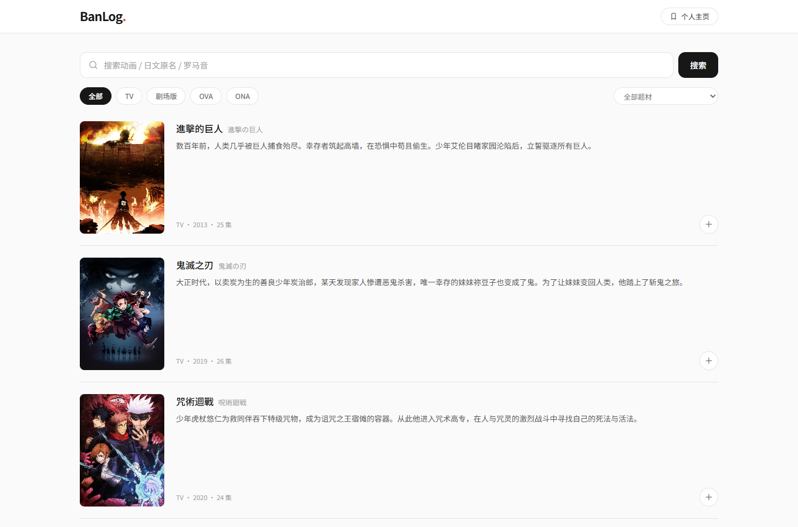

# BanLog

**中文优先、本地优先的日本动画追番记录统计。**

BanLog 用 AniList 获取动画资料，以本地中文标题映射显示译名，并将中文简介缓存到 SQLite。无需登录，没有云同步，提供网页版和 Windows 便携版。

[](https://nextjs.org)
[](https://www.typescriptlang.org/)
[](https://learn.microsoft.com/microsoft-edge/webview2/)
[](LICENSE)

> **Windows 用户**：[下载 BanLog 2.1.0](https://github.com/Sato017/banlog/releases/latest)，解压后双击 `BanLog.exe`。



## 功能

- 中文标题为主，日文原名作为副标题。
- 类型筛选：TV / 剧场版 / OVA / ONA。
- 题材筛选：Action / Romance / Sci-Fi 等。
- 中文简介翻译并缓存；翻译不可用时回退英文。
- 卡片标记已追，个人主页查看统计。
- 单用户 SQLite，本地保存，无需账号。

## Windows 版

从 [Releases](https://github.com/Sato017/banlog/releases/latest) 下载 `BanLog-2.1.0-win64.zip`，解压到可写目录并运行 `BanLog.exe`。

数据默认保存在程序旁的 `BanLogData/`。系统需要 WebView2 Runtime，Windows 11 通常已自带。更多说明见 [desktop/README.txt](desktop/README.txt)。

## 从源码运行

要求 Node.js 20+。

```bash
npm install
cp .env.example .env
npm run db:migrate
npm run dev
```

打开 <http://127.0.0.1:3000>。

构建 Windows 桌面版：

```bash
npm run desktop:build
```

## 技术栈

Next.js 15 · React 19 · TypeScript · Tailwind CSS · Prisma 6 · SQLite · AniList GraphQL · WinForms + WebView2

## 数据说明

- 动画资料与封面来自 AniList。
- 中文标题来自本地 [soruly/anilist-chinese](https://github.com/soruly/anilist-chinese) 映射。
- 追番记录与中文简介缓存保存在本地 SQLite。
- 中文简介翻译失败时自动展示英文简介，不影响使用。

## License

本项目以 [MIT License](LICENSE) 发布。

中文标题数据遵循其 MIT License，声明见 [`data/anilist-chinese-NOTICE.txt`](data/anilist-chinese-NOTICE.txt)。WebView2 许可见 [`launcher/vendor/webview2/LICENSE.txt`](launcher/vendor/webview2/LICENSE.txt)。
